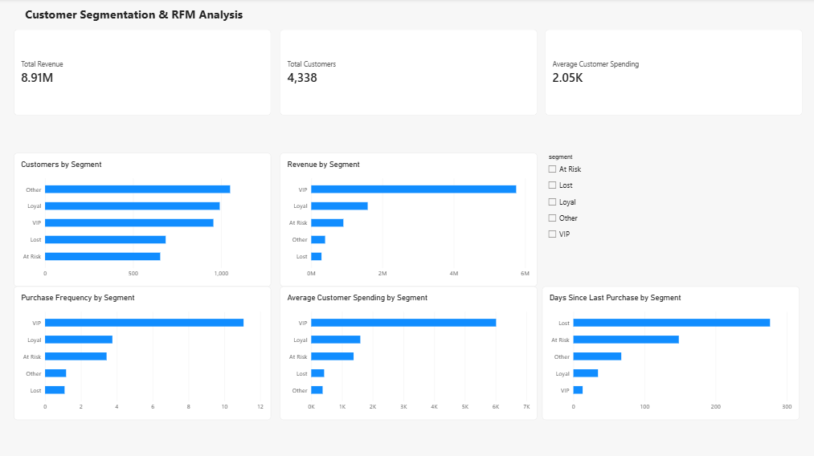

# Customer Segmentation & RFM Analysis
## Power BI Dashboard


## Project Overview

This project analyzes customer purchasing behavior using Recency, Frequency, and Monetary (RFM) analysis.

The objective is to identify valuable customers, detect retention risks, and provide actionable business recommendations.

**Technologies:** Python, pandas, JupyterLab, PostgreSQL 15, SQL, Power BI Desktop

**Dataset:** Online Retail  
**Analysis period:** December 1, 2010 – December 9, 2011

## Client Use Case

This analysis helps retailers identify their highest-value customers, prioritize retention campaigns, and focus marketing budgets where they can protect the most revenue. A client can replace the sample data with transaction history to receive validated RFM segments, revenue concentration analysis, an at-risk customer list, and an interactive Power BI dashboard.

## 1. Business Objectives

- Identify high-value customers.
- Understand customer purchasing frequency and spending.
- Detect customers at risk of disengagement.
- Identify retention and revenue-growth opportunities.
- Develop an interactive dashboard supporting business decisions.

## 2. Data Processing Pipeline

The project follows this workflow:

```text
Online Retail.xlsx
       |
       v
Python / pandas / JupyterLab
       |
       v
Data Cleaning and Validation
       |
       v
PostgreSQL — project5_rfm
       |
       v
RFM Calculations
       |
       v
Customer Segmentation
       |
       v
customer_segments.csv
       |
       v
Power BI Dashboard
       |
       v
Business Report
```

The raw dataset was processed to address missing customer identifiers, invalid quantities, and invalid prices.

Customer-level RFM metrics and segment assignments were calculated and stored in PostgreSQL.

The resulting `customer_segments` table was exported to CSV for Power BI.

**Important:** The Power BI report uses a CSV import rather than a live PostgreSQL connection. Updating the dashboard requires regenerating the CSV and refreshing the Power BI data.

## 3. RFM Methodology

RFM evaluates customers across three dimensions:

**Recency (R):** Number of days since a customer's most recent purchase.

**Frequency (F):** Number of purchases made by the customer.

**Monetary (M):** Total monetary value of the customer's purchases.

PostgreSQL calculates scores from 1 to 5 using the `NTILE(5)` window function.

```sql
NTILE(5) OVER (ORDER BY recency DESC) AS r_score,
NTILE(5) OVER (ORDER BY frequency ASC) AS f_score,
NTILE(5) OVER (ORDER BY monetary ASC) AS m_score
```

Higher scores indicate more recent purchasing activity, greater purchasing frequency, or higher monetary value.

## 4. Customer Segmentation Rules

Customers are assigned to five segments using an ordered SQL `CASE` expression.

| Segment | Assignment Rule |
|---|---|
| VIP | R ≥ 4 AND F ≥ 4 AND M ≥ 4 |
| Loyal | R ≥ 3 AND F ≥ 3, excluding VIP |
| At Risk | R ≤ 2 AND F ≥ 3 |
| Lost | R ≤ 1 AND F ≤ 2 |
| Other | Customers not matching earlier conditions |

The rules are evaluated in sequence. Each customer receives the first matching classification.

## 5. Validated Business Results

| Metric | Value |
|---|---:|
| Total customers | 4,338 |
| Total historical monetary value | $8,911,407.90 |
| Average monetary value per customer | $2,054.27 |
| Customer segments | 5 |

### Customer Distribution

| Segment | Customers | Customer % | Historical Revenue | Revenue % |
|---|---:|---:|---:|---:|
| VIP | 956 | 22.04% | $5,750,101.20 | 64.53% |
| Loyal | 992 | 22.87% | $1,583,617.10 | 17.77% |
| At Risk | 654 | 15.08% | $901,325.71 | 10.11% |
| Lost | 685 | 15.79% | $287,414.02 | 3.23% |
| Other | 1,051 | 24.23% | $388,949.87 | 4.36% |

Percentages are rounded.

### Customer Purchasing Behavior

| Segment | Avg. Recency (Days) | Avg. Frequency | Avg. Monetary Value |
|---|---:|---:|---:|
| VIP | 12.99 | 11.07 | $6,014.75 |
| Loyal | 34.58 | 3.75 | $1,596.39 |
| At Risk | 148.17 | 3.43 | $1,378.17 |
| Lost | 276.40 | 1.09 | $419.58 |
| Other | 67.30 | 1.17 | $370.08 |

## 6. Quality Assurance

The following checks were completed:

| Validation | Result |
|---|---|
| Customer records | 4,338 |
| Distinct customer IDs | 4,338 |
| RFM score ranges | 1–5 |
| Missing RFM scores | 0 |
| Missing segment values | 0 |
| Invalid segment assignments | 0 |
| Revenue reconciliation | PASS |
| Segment distribution checks | PASS |

**Segmentation QA:** All 4,338 customer assignments were independently recalculated in Python and compared against the stored PostgreSQL results.

**Result: PASS — Zero incorrect assignments.**

These checks confirm the tested outputs; they do not constitute exhaustive validation of every upstream data-cleaning or transformation step.

## 7. Power BI Dashboard

The final dashboard contains three sections.

**Business Overview**
- Total Revenue
- Total Customers
- Average Customer Spending

**Customer Segmentation**
- Customers by Segment
- Revenue by Segment
- Interactive Segment Filter

**Customer Behavior**
- Purchase Frequency by Segment
- Average Customer Spending by Segment
- Days Since Last Purchase by Segment

The dashboard uses a 1920 × 1080 (16:9) canvas.

**Final Power BI deliverable:**

`Customer_Segmentation_RFM_Analysis.pbix`

## 8. Key Business Findings

**Revenue concentration:** VIP customers represent 22.04% of customers but contribute 64.53% of historical revenue.

**Retention opportunity:** At Risk customers represent $901,325.71 in historical spending and average 148.17 days since their last purchase.

**Growth opportunity:** Loyal customers exhibit repeat-purchase behavior and may be candidates for targeted cross-selling and increased engagement.

**Customer recovery:** Lost customers have substantially longer inactivity and lower historical spending, suggesting that recovery campaigns should be carefully targeted and evaluated for cost-effectiveness.

## 9. Recommended Business Actions

1. Protect VIP relationships through personalized engagement and loyalty programs.
2. Test targeted reactivation campaigns for At Risk customers.
3. Develop Loyal customers through relevant cross-selling opportunities.
4. Encourage second purchases among low-frequency customers.
5. Monitor retention, segment migration, repeat purchases, and campaign return on investment.

Recommendations are hypotheses to be tested, not established campaign results.

## 10. Project Deliverables

- `Customer_Segmentation_RFM_Analysis.ipynb` — analysis notebook and validation tests.
- `customer_segments.csv` — customer-level RFM and segmentation output.
- `Customer_Segmentation_RFM_Analysis.pbix` — final interactive Power BI report.
- `Customer_Segmentation_RFM_Executive_Summary.pdf` — client-facing executive summary.
- `README.md` — technical documentation.

## 11. Limitations

- The analysis uses historical transactions from December 2010 through December 2011.
- Results are descriptive and do not predict future customer behavior.
- Historical customer spending does not represent guaranteed future revenue.
- Customer segment classifications depend on the selected RFM rules.
- The Power BI report imports a static CSV and does not automatically refresh from PostgreSQL.
- Customer retention initiatives require testing and subsequent measurement.

## 12. Conclusion

This project demonstrates an end-to-end customer analytics workflow combining data processing, PostgreSQL-based RFM segmentation, quality assurance, Power BI visualization, and actionable business reporting.

The principal business finding is that customer revenue is highly concentrated among VIP customers, while previously active customers represent opportunities for carefully measured retention initiatives.


